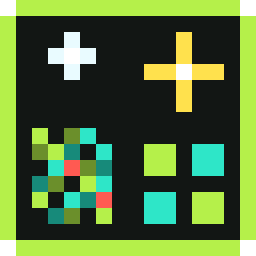
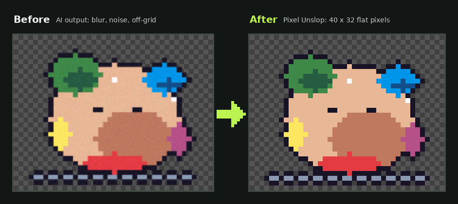
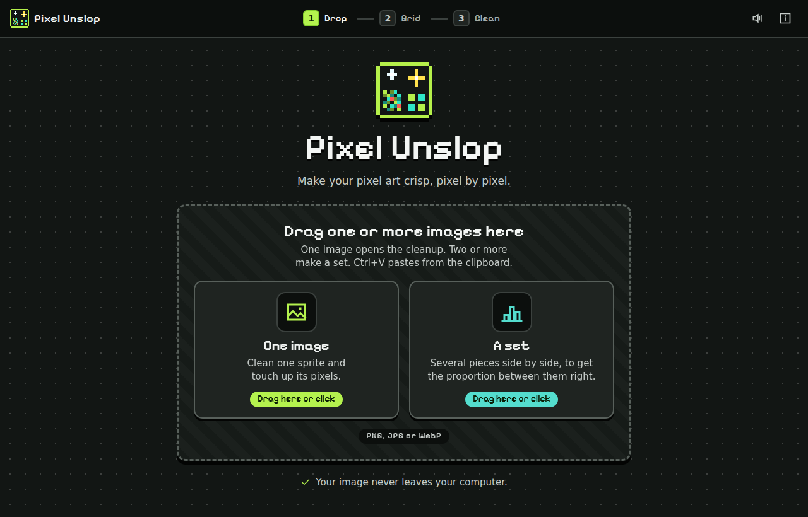
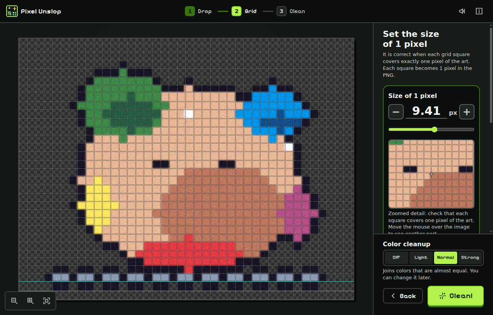
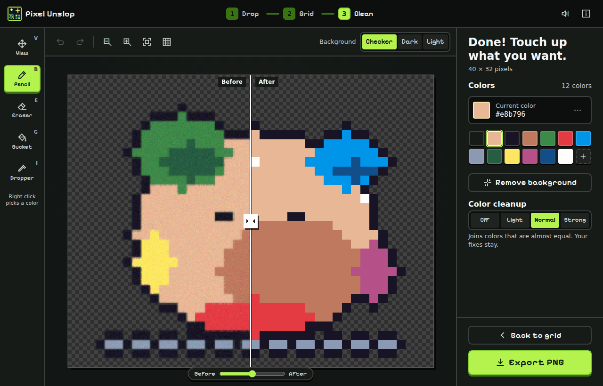
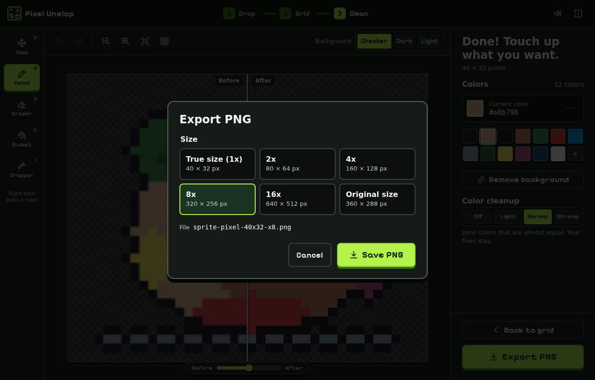
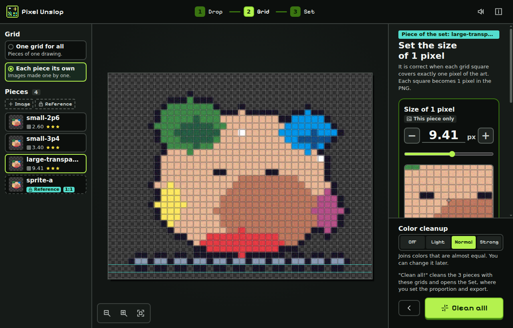
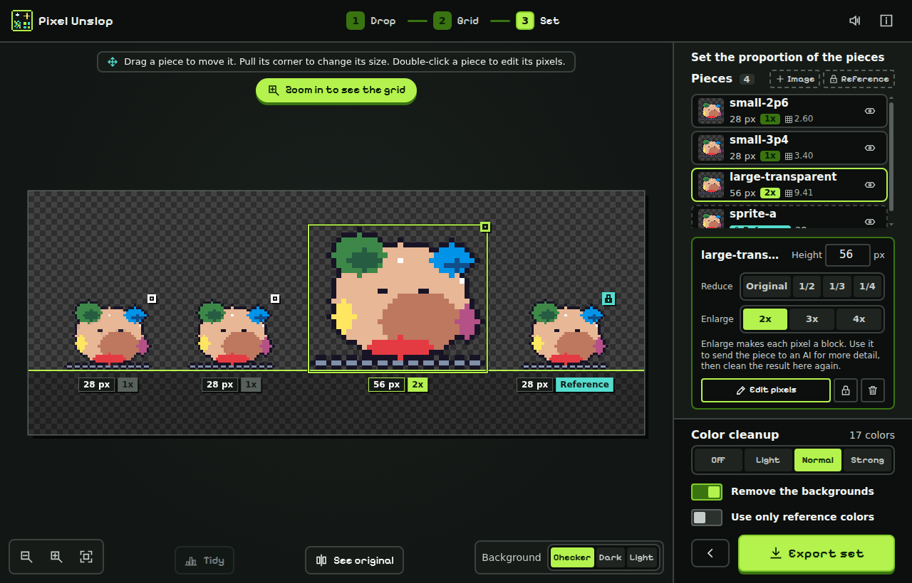

<p align="center">
  
</p>

<h1 align="center">Pixel Unslop</h1>

<p align="center"><strong>Fix AI-generated pixel art. Pixel Unslop snaps it to a true pixel grid, makes each tile one flat color and merges the palette into a pixel-perfect sprite.</strong></p>

<p align="center">
  
</p>

Pixel Unslop cleans AI pixel art and converts it to real pixel art. It removes the blur, the noise and the anti-aliased edges. It reduces hundreds of near-equal colors to a clean color palette. It also downscales the image to its true resolution: one image pixel for each art pixel.

Use it for sprites and game assets from AI image generators such as ChatGPT, DALL-E, Midjourney, Stable Diffusion, Gemini and others. The tool does not depend on the generator.

**What makes it different:** it is deterministic and uses no generative AI. Your image never leaves your computer. It is free and open source (MIT). You get a Windows desktop app and a command line tool for AI agents.

## Download Pixel Unslop for Windows

Download the free Windows app and the command line tool from the [latest release](https://github.com/salvimateus/pixel-unslop/releases/latest). There is no installer and no account.

| File | For | Needs |
|---|---|---|
| `PixelUnslop.exe` | The Windows desktop app. One portable file, no installer. | Windows 10 or 11 with the WebView2 runtime (Windows 11 has it) |
| `pixel-unslop-cli.exe` | The command line tool for Windows | Nothing more |
| `pixel-unslop-cli-wsl.tar.gz` | The command line tool for WSL or Linux. It holds `pixel-unslop` and `pixel-unslop.cjs`. | Node.js 20 or newer |

> [!WARNING]
> **Windows shows "Windows protected your PC" at the first start.** You see this blue screen when you open `PixelUnslop.exe` or `pixel-unslop-cli.exe` for the first time.
>
> The cause: the files have no paid code signing certificate. This is usual for small open source programs. It does not mean that the file has a virus.
>
> To continue:
>
> 1. Click "More info".
> 2. Click "Run anyway".
>
> To make sure that the file is the original, compare its SHA-256 hash with the value in the release notes. In PowerShell, run this command in the folder of the file:
>
> ```powershell
> Get-FileHash .\PixelUnslop.exe -Algorithm SHA256
> ```
>
> The source code is public in this repository. You can also [build the files yourself](#how-to-build-pixel-unslop-from-source).

To start the desktop app, double-click `PixelUnslop.exe`.

To use the command line tool on WSL or Linux, extract the file:

```sh
tar -xzf pixel-unslop-cli-wsl.tar.gz
```

Then run the tool from the same folder:

```sh
./pixel-unslop --help
```

You can also [build Pixel Unslop from source](#how-to-build-pixel-unslop-from-source).

## Contents

- [Download Pixel Unslop for Windows](#download-pixel-unslop-for-windows)
- [Why AI pixel art is not real pixel art](#why-ai-pixel-art-is-not-real-pixel-art)
- [Who it is for](#who-it-is-for)
- [How to fix AI pixel art in 4 steps](#how-to-fix-ai-pixel-art-in-4-steps)
- [Make AI sprites the same scale with the set mode](#make-ai-sprites-the-same-scale-with-the-set-mode)
- [What Pixel Unslop can do](#what-pixel-unslop-can-do)
- [Clean AI pixel art from the command line (for AI agents)](#clean-ai-pixel-art-from-the-command-line-for-ai-agents)
- [How Pixel Unslop finds the pixel grid](#how-pixel-unslop-finds-the-pixel-grid)
- [How to build Pixel Unslop from source](#how-to-build-pixel-unslop-from-source)
- [Known limits](#known-limits)
- [Frequently asked questions](#frequently-asked-questions)
- [Credits](#credits)
- [License](#license)

## Why AI pixel art is not real pixel art

AI image generators make images that look like pixel art, but the pixels are not on a real pixel grid. You see these defects:

- Off-grid pixels: the art pixels have different sizes and positions.
- Lines that are not straight.
- Blur and anti-aliased edges between the colors.
- Noise in areas that must have one flat color.
- Hundreds of colors that are almost equal, where the art needs a small palette.

A game engine or a pixel art editor needs one flat color for each art pixel. Pixel Unslop finds the grid of the art and makes each tile one flat color. Then it merges the near-equal colors into a clean palette.

## Who it is for

- Game developers who use AI images as game assets.
- Pixel artists who want a clean base from an AI sketch.
- People who make sprites and game assets with AI image generators.
- AI agents, for example Claude Code, that process images with the command line tool.

## How to fix AI pixel art in 4 steps

### 1. Drop the image

Open Pixel Unslop. Drag a PNG, JPG or WebP image into the window. The drop screen shows two choices: "One image" and "A set".

- To clean one image, click "One image" and select the file.
- To paste an image, push Ctrl+V.
- To make several sprites the same scale, click "A set", or drop two or more images. See [the set mode](#make-ai-sprites-the-same-scale-with-the-set-mode).

In the desktop app, you can change the size of the interface. The app starts at 125%, or at 100% on a small screen, and keeps your zoom for the next start. The window opens at 1600 by 900 pixels, or smaller on a smaller screen. The app keeps the window size, the window position and the maximized state for the next start.

- To make the interface larger, push Ctrl and +.
- To make the interface smaller, push Ctrl and -.
- To go back to the start zoom, push Ctrl and 0.

Each step is 5%, from 50% to 200%. An indicator shows the zoom in percent, with "−", "+" and "Reset" buttons. In a browser, use the zoom of the browser.



### 2. Set the size of 1 pixel

The Grid step has one main job: set the size of one art pixel. The grid defines what 1 pixel of the art is, and each square of the grid becomes 1 pixel in the exported PNG. The result is correct when each square covers exactly one pixel of the art. The program finds the size and shows the grid on your image. Three stars show a good fit.

The "Size of 1 pixel" control is the first and largest control of the panel. A zoomed detail below it shows the art with the grid, so you can see each square clearly. Move the mouse over the image to see another part in the detail.

Set the size in one of these ways, in order of use:

1. Move the slider, type the size, or click the "−" and "+" buttons. The grid on the image changes while you move the slider. The arrow keys change the size by 0.01, and Shift with an arrow key changes it by 0.1.
2. Mark 1 pixel on the image: drag a square over ONE pixel of the art. The square follows the larger movement of the mouse, so the art pixel stays square. A magnifier shows the area, and the grid that your square gives shows while you drag. The grid aligns to your square: one cell sits on it, even when the full grid must move, and the grid keeps the size of your square. Later size changes keep that cell in place. If the edges of the art show another pixel size, a notice under the size tells you, and its button applies that size.
3. Click "Detect for me" to find the size again from the image. This also removes a marked square and an offset of the grid.

To move the full grid with no change of size, hold Ctrl and drag on the image. The grid follows the pointer and stays where you release it. The arrow buttons in "Advanced" show the new offset, and "Reset" removes it. When a square is marked, an outline shows the marked cell. Click "Release" to remove the mark: the size stays, and the grid goes back to its automatic position.

Two tools are for special cases:

- "Adjust lines" moves single grid lines. A drag of a line pushes the next lines, and they keep their sizes. A drag of the first line moves the full grid. Hold Alt to move one line only. A line snaps to the edges of the drawing, and Shift moves it freely. A double click removes a line, or splits a large square. Every edit keeps a valid grid, and Ctrl+Z undoes it.
- "Advanced" has three controls. "Move the full grid" has four arrow buttons. Use them when the squares have the correct size but sit a little off the pixels of the art. "Flexible grid" lets each grid line follow the real edge of each row and column, because AI art often has squares of different sizes in one image. On Auto, it turns on when the art pixel is 4 px or larger and the grid is not weak. The teal lines show where it moved a line. "My art is stretched" is for art whose small squares look like rectangles, as a picture squeezed on a TV. Turn it on and move the "Pixel shape" slider until the grid covers each rectangle, or mark one rectangle on the image. The size control keeps the size, and "Square" makes the pixel square again.

Then select the "Color cleanup" level (Off, Light, Normal or Strong) and click "Clean!". You can change the level later.



### 3. Clean and correct the sprite

The program shows the clean sprite. To compare it with the source, move the divider or the "Before / After" slider.

- To correct small defects, use the Pencil (B), the Eraser (E), the Bucket (G) and the Dropper (I).
- To paint or erase more pixels at a time, set the brush size of the Pencil or the Eraser, from 1 to 32 squares. Use the "Size" control in the toolbar, or push `[` and `]`. Each tool keeps its own size. The outline under the pointer shows the exact squares that a click changes.
- To pick the color below the cursor, click the right mouse button. This works in all tools.
- To replace a color in all the sprite, right-click it in the color list. You can also click the "..." button. You can also erase the color there.
- To make the background transparent, click "Remove background". This changes the background that touches the border.
- When the sprite has an empty border, a faint dashed box shows the part that the export writes.
- You can change the "Color cleanup" level at any time. Your manual corrections stay.
- To undo, push Ctrl+Z. To redo, push Ctrl+Y.



### 4. Export the PNG

Click "Export PNG", or push Ctrl+S. The dialog shows the size in pixels and the file name. To change the name, click the pencil next to it, type the new name and push Enter. Keep "Optimize PNG" on to get a smaller file with exactly the same pixels; the dialog shows the size before and after the optimization and the saving in percent. Then click "Save PNG".

The output is always 1 image pixel for each art pixel. There is no upscale choice: an asset at 8x next to an asset at 1x is not on the same grid in a game. If your game engine shows sprites larger, scale them there, with nearest-neighbor filtering.

The export always has the smallest size: the program crops the PNG to the box of its visible pixels, and it cuts no visible pixel. When the crop removes an empty border, the dialog tells you, and the file name shows the cropped size. A sprite with no visible pixel cannot be exported.



## Make AI sprites the same scale with the set mode

An AI image generator draws each object at its own density. For example, it can draw a tree 120 art pixels high and a monkey 200 art pixels high. After the cleanup, each file has a correct pixel grid, but the monkey is larger than the tree. The palettes are also different. The set mode puts the sprites on one common pixel grid, so you can set the proportion between them side by side.

The set mode has the same three steps as one image: "Drop", "Grid" and "Set".

1. On the drop screen, click "A set" and select one or more images. You can also drop two or more images at the same time.
2. The Grid step opens. It shows the original image of one piece with its grid, and it has all the tools of the Grid step of one image. The list on the left shows each piece with its pixel size and its stars. A "weak grid" badge shows a piece that needs attention, a lock shows a reference, and "1:1" shows an image that is already pixel art. Click a piece to show it.
3. Select the grid of the set. The app selects one for you:
   - "One grid for all": for pieces of one drawing, such as the parts of a character rig. All the pieces get one pixel size, so they keep their original proportion. The app detects the size from all the pieces together. A size that you set on one piece applies to all the pieces, and "Detect for me" finds the common size again.
   - "Each piece its own": for images that you generated one by one, such as a tree and a monkey. Each piece gets its own pixel grid, and the size control changes only the piece on the screen.
4. Click "Clean all!". The app cleans each piece with its grid, removes the background and crops each sprite to its opaque pixels. Then the Set step opens.
5. In the Set step, the sprites stand side by side on one ground line. One square of the grid is one pixel of the exported PNG files.
6. Drag the small square at the top corner of a sprite to change its height. The preview is the exact result of the export. The corner snaps to the clean sizes: whole reductions (1/2 to 1/8) and whole enlargements (2x to 4x). Hold Shift to set a free height.
7. Each sprite shows its height ("32 px") and its ratio ("1/2", "2x"). You can also type the height, use the arrow keys, or click a preset: "Reduce" has 1/2, 1/3 and 1/4, and "Enlarge" has 2x, 3x and 4x. A height above the largest permitted height becomes that height, and a message tells you the value.
8. Hold "See original", or the O key, to see the original image of each piece in place. Release it to see the result again.
9. To compare two pieces, drag a piece along the ground line, or push the left and right arrow keys. A reference stands on the ground line by its visible pixels, and you can move it too. "Tidy" puts each piece back in its automatic place. A move does not change the exported files.
10. To hide a piece in the scene, click the eye in its row, or push H. A hidden piece is still exported.
11. Click "Edit pixels", double-click the piece, or push Enter to correct the pixels of one sprite with the pencil, the eraser, the bucket and the dropper. Click "Back to the set" to go back with your edits. To change the grid of a piece, click "Back to the grid" in the Set step. If no grid changes, the Grid step shows "Back to the set" in place of "Clean all!", and your edits, sizes, places and hidden pieces stay. A grid change that drops the edits of a piece asks first, and the other pieces keep their edits.
12. Click "Export set" and select the files with the checkboxes. To change the name of a file, click the pencil next to it. Two files cannot have the same name. On the desktop app, you get one PNG for each sprite in a folder. In a browser, you get one PNG, or one ZIP file that holds all the selected PNG files. Each PNG has the true resolution, and all of them share one palette. A resize never adds a new color.

You can enlarge a small piece up to 4x. Each pixel then becomes a block of 2, 3 or 4 pixels. You can send this blocky PNG to a generative AI to get more detail, and then clean the new image here again. In the command line tool, give the height with `--height file.png=N`:

```sh
pixel-unslop clean small.png --out-dir big --height small.png=96
```

To add more images later, click "+ Image" in the Grid step or in the Set step. New pieces open in the Grid step, so you can examine their grid.



To clean a new sprite next to an asset that is already final in your game, add that asset with "+ Reference", or select "Reference" on a piece. A reference is locked: the app does not change its pixels, its colors or its size, and it does not export it. Turn on "Use only the colors of the reference" to map the other pieces to the colors of the reference.

The background removal works only for a flat background of one color or for a fake checkerboard. Thus, generate each object on a flat background of one color. When the app cannot remove the background of an image, the sprite and its row show a "background" badge, and a message tells you what to do.



## What Pixel Unslop can do

- Automatic pixel grid detection, with a rating of the fit from 1 to 3 stars.
- A pixel size control with a live grid and a zoomed detail, so you can see if each square covers one art pixel.
- Manual correction: a square over one art pixel, a pixel size with steps of 0.01 px, or grid lines that you move one by one.
- Advanced grid controls: a flexible grid for art that moves away from the grid, arrow buttons that move the full grid, and a pixel shape slider for stretched art, where the pixels are not square.
- One flat color for each tile, with no blur.
- Pixel art cleanup of the colors in four levels, in the OKLab color space. The merge agrees with what the eye sees.
- Pencil, eraser, bucket fill and dropper, with undo and redo. The pencil and the eraser have a brush size from 1 to 32 squares.
- Replace a color in all the sprite, erase a color, or remove the background with one click.
- A comparison of the source and the result, on a checker, dark or light background.
- PNG export at the true resolution: always 1 image pixel for each art pixel.
- The smallest PNG size: each export is cropped to its visible pixels, and no visible pixel is cut.
- Lossless PNG optimization: smaller files with exactly the same pixels.
- A set mode for several sprites in three steps: a Grid step for all the pieces, one pixel grid for all the pieces or one for each piece, a visual resize with a snap to clean sizes, a comparison with the originals, one shared palette, locked reference pieces, and an export of the selected files.
- An interface in English and in Brazilian Portuguese, with an interface zoom from 50% to 200% in the desktop app.
- A desktop window that keeps its size, its position and its zoom for the next start.
- It works offline. There is no account, no upload and no telemetry.

## Clean AI pixel art from the command line (for AI agents)

The same engine is also a command line tool. It is for AI agents, such as Claude Code, and for scripts. Use it to clean many sprites in one run, to read a JSON report, and to correct single tiles with exact commands. Get the files from the [latest release](https://github.com/salvimateus/pixel-unslop/releases/latest).

| File | Platform | Requirement |
|---|---|---|
| `pixel-unslop` (with `pixel-unslop.cjs`) | WSL or Linux | Node.js 20 or newer |
| `pixel-unslop-cli.exe` | Windows | None (Node.js is in the file) |

The examples use the name `pixel-unslop`. On Windows, use `pixel-unslop-cli.exe` with the same options. The tool reads only PNG files.

Clean one image and make its background transparent:

```sh
pixel-unslop clean hero.png --erase-background
```

Clean the parts of one sprite sheet with one pixel size and one palette for all the parts:

```sh
pixel-unslop clean pieces/*.png --out-dir clean --shared-pixel-size --shared-palette --write-palette clean/palette.txt
```

Write the smallest lossless PNG files. The pixels stay exactly the same:

```sh
pixel-unslop clean pieces/*.png --out-dir clean --shared-palette --optimize
```

Each output is cropped to the box of its opaque pixels, so it has the smallest size and loses no opaque pixel. To keep the full frame, for example for the frames of an animation that must keep one size, add `--no-trim`:

```sh
pixel-unslop clean walk-*.png --out-dir walk --shared-palette --erase-background --no-trim
```

Make the sprites of one scene the same scale. Each output is resized to the height that you give, with one palette for all the outputs. The app gives the same pixels for the same images and heights:

```sh
pixel-unslop clean tree.png monkey.png --out-dir scene --shared-palette --erase-background --height tree.png=48 --height monkey.png=32
```

To find the clean heights first, read the `object.reductions` field of this report. A whole reduction keeps the most detail:

```sh
pixel-unslop inspect tree.png monkey.png --json
```

Read the grid and the palette as JSON. This command writes no image:

```sh
pixel-unslop inspect hero.png --json
```

Write a preview of the source with the grid lines. Use it to examine the grid:

```sh
pixel-unslop inspect hero.png --grid-preview hero-grid.png
```

Edit a clean sprite. This example sets one tile, then fills the background area with transparency:

```sh
pixel-unslop edit hero-pixel-40x32.png --set 10,4=#ff0000 --fill 0,0=transparent -o hero-fixed.png
```

The output of `clean` and `edit` is always 1 image pixel for each art pixel. To edit an asset that was upscaled before, give `edit --from-scale <k>`: the tool reads each k by k block as one tile and writes the sprite back at 1x.

With `--json`, the tool writes one JSON report to stdout. The report gives the output file, the grid, the number of colors and the palette. The grid data includes the pixel size, the offset, a quality from 1 to 3 and notes.

The exit codes are:

- 0: all files are correct.
- 1: one file or more failed.
- 2: a usage error.

For all the options and more examples, run `pixel-unslop help`, `help clean`, `help inspect` or `help edit`.

## How Pixel Unslop finds the pixel grid

1. **Edge evidence.** The tool measures the color change between adjacent pixels, along each column and each row.
2. **Grid period and phase.** In real pixel art, the edges have a regular step. The tool finds the step (the size of one art pixel) and the offset where the edges agree best. A box that you draw over one pixel gives a strong hint. If the AI art moves away from a regular grid, an elastic fit moves the grid lines to the edges.
3. **One color for each tile.** The tool examines the center of each tile. It uses the color with the largest area there. The blurred border of the tile has no effect.
4. **Palette merge.** The tool merges the colors that are almost equal in the OKLab color space. The cleanup level sets the maximum difference.

## How to build Pixel Unslop from source

To get the programs with no build, use the [download](#download-pixel-unslop-for-windows). To build them yourself, use the steps below. The build operates on Linux or WSL. It makes the Windows programs with a cross-compiler.

### Requirements

- Node.js 24.10.0, exactly. The Windows CLI build stops with a different version. The build puts the CLI into the official Node.js 24.10.0 Windows binary.
- Rust (with `rustup`) and the Windows target: `rustup target add x86_64-pc-windows-msvc`.
- cargo-xwin: `cargo install cargo-xwin --locked`.
- The LLVM tools. On Ubuntu or WSL: `sudo apt install clang lld llvm`.

The first Windows build downloads the Windows SDK and CRT files with cargo-xwin. The Windows CLI build downloads `node.exe` 24.10.0 from nodejs.org. Then it examines the SHA-256 hash of the file.

### Commands

Install the dependencies:

```sh
npm ci
```

Open the interface in your browser at http://localhost:5173:

```sh
npm run dev
```

Build all the programs:

```sh
npm run release
```

The build writes these files into the `release/` folder:

| Path | Content |
|---|---|
| `release/windows/PixelUnslop.exe` | The Windows desktop app (portable, with no installer) |
| `release/windows/pixel-unslop-cli.exe` | The command line tool for Windows |
| `release/wsl/pixel-unslop` | The command line tool for WSL or Linux (a small launcher) |
| `release/wsl/pixel-unslop.cjs` | The CLI file that the launcher runs with Node.js |

To build only the CLI for Linux or WSL, run `npm run build:cli`. This command writes `dist-cli/pixel-unslop.cjs`.

## Known limits

- The background removal works only for a flat background of one color or for a fake checkerboard. It does not remove a scenery, such as a sky, grass or a gradient. Generate each object on a flat background of one color.
- A small, blurred image gives little edge evidence. Thus the automatic grid can be incorrect.
  - In the app, set the size of 1 pixel, or drag a square over one pixel of the art.
  - In the CLI, give `--pixel-size`. Or clean the parts of one sheet together with `--shared-pixel-size`.
- The Windows files have no paid code signing certificate. Thus Windows shows "Windows protected your PC" at the first start. Click "More info", then "Run anyway". See [the warning in the download section](#download-pixel-unslop-for-windows).
- The desktop app needs Windows 10 or 11 with the Microsoft Edge WebView2 runtime. Windows 11 has it.

## Frequently asked questions

### How do I fix AI-generated pixel art?

Open the image in Pixel Unslop. Set the size of 1 pixel, click "Clean!", correct small defects and export the PNG. The [4 steps](#how-to-fix-ai-pixel-art-in-4-steps) above show the full procedure.

### Does Pixel Unslop use AI?

No. It uses no generative AI and no machine learning. It uses only math, and the same image and settings always give the same result.

### Does it work with images from Midjourney, DALL-E, Stable Diffusion or ChatGPT?

Yes. The tool does not depend on the generator. It needs an image that shows pixel art on an approximate grid. The desktop app opens PNG, JPG and WebP files. The command line tool reads PNG files.

### How do I find the pixel size of my image?

The program finds it automatically. If the result is not correct, set the "Size of 1 pixel" control and look at the zoomed detail, or drag a square over one art pixel. In the command line tool, run `pixel-unslop inspect image.png` to read the pixel size, or give it with `--pixel-size`.

### Why does my result have too many or too few colors?

The "Color cleanup" level controls the merge of near-equal colors. For fewer colors, select a stronger level. To keep more colors, select a lighter level or Off. The command line tool also has `--cleanup`, `--max-colors` and `--palette`.

### Can I clean many sprites with one palette?

Yes. In the desktop app, drop two or more images at the same time. The [set mode](#make-ai-sprites-the-same-scale-with-the-set-mode) gives all the sprites one palette and one pixel grid, and exports one PNG for each sprite. In the command line tool, use `--shared-palette` to give all the outputs one palette. Add `--shared-pixel-size` for the parts of one sprite sheet, and `--height` to resize each sprite.

### Can I export the sprite at a larger size?

No. The output is always 1 image pixel for each art pixel, so all your assets stay on the same grid. Scale the sprites in your game engine, with nearest-neighbor filtering.

### Why does Windows show "Windows protected your PC" for Pixel Unslop?

The Windows files have no paid code signing certificate, so Windows SmartScreen does not know them yet. The warning does not mean that the file has a virus. Click "More info", then "Run anyway". To make sure that the file is the original, compare its SHA-256 hash with the release notes. See [the warning in the download section](#download-pixel-unslop-for-windows).

### How do I download Pixel Unslop for Windows?

Open the [latest release](https://github.com/salvimateus/pixel-unslop/releases/latest) and download `PixelUnslop.exe`. It is one portable file with no installer. See [Download Pixel Unslop for Windows](#download-pixel-unslop-for-windows) for the command line files.

### Is it free?

Yes. Pixel Unslop is free and open source, with the MIT license.

### Does it run offline?

Yes. The desktop app and the command line tool need no internet connection. Your image stays on your computer.

## Credits

The algorithm uses ideas from these MIT projects:

- [unfake.js](https://github.com/jenissimo/unfake.js)
- [proper-pixel-art](https://github.com/KennethJAllen/proper-pixel-art)
- [Sprite Fusion Pixel Snapper](https://github.com/Hugo-Dz/spritefusion-pixel-snapper)

## License

MIT. Made by Mateus Salvi ([@salvimateus](https://github.com/salvimateus)). See [LICENSE](LICENSE).
